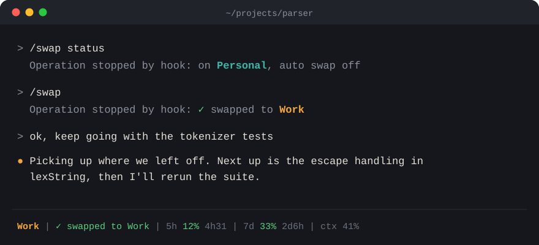

<p align="center"></p>

<h1 align="center">swaphat</h1>

<p align="center">Type <code>/swap</code> in Claude Code and the next message goes out on your other account.<br>The session keeps running and the chat stays put.</p>

<p align="center"></p>

I have a personal Claude plan and a work one. I got sick of `/logout`, `/login`, losing my place, and doing it all again when one plan ran out halfway through something. So now I just type `/swap`.

## What it does

- `/swap` inside Claude Code switches the session to your other account. The swap itself takes well under a second.
- `/swap auto on` swaps for you when you hit a usage limit. On Windows it also tells the session to carry on.
- A status line that shows which account you're on, your 5h and 7d usage, and how much context is used.
- `swaphat doctor` tells you what's set up and what isn't.

It's plain Node with no dependencies. Nothing leaves your machine. `/swap` runs as a hook, so it doesn't use a model call.

If you want more than two accounts, a usage dashboard or rotation strategies, use [realiti4/claude-swap](https://github.com/realiti4/claude-swap) instead. It's a much bigger tool. swaphat only does the in-chat swap.

## How it works

Claude Code keeps its login in `<config dir>/.credentials.json`. On macOS it's in the Keychain instead. Either way it re-reads the login when it changes.

You keep one account logged in to `~/.claude` and the other to a second dir (`~/.claude-second`). `/swap` exchanges the two logins, and any session on `~/.claude` picks up the other account on its next message.

- Logins are exchanged, never copied, so a refresh token only ever lives in one place.
- Only the claude.ai login moves. MCP tokens and the rest of the file stay where they are.
- A lock stops two swaps from running at once. If the second write fails, the first one gets undone.
- It refuses to swap when both dirs hold the same account, because that's usually a login mistake.

## Install

Needs Node 18+ and Claude Code logged in with a claude.ai account (Pro, Max, Team or Enterprise).

```sh
npx github:mkayultrah/swaphat install --names "Personal,Work"
```

Or clone it and run `node install.js --names "Personal,Work"`.

The first name is the account you're logged in with now. Then log in the second one:

```sh
swaphat login
```

Pick the **other** account in the browser. If you're in more than one org under the same email, switch org on claude.ai first. Then restart any open Claude Code sessions.

`swaphat` is available as a command if `~/.local/bin` is on your PATH, which it usually is if you installed Claude Code with its own installer. If it isn't, run `node ~/.swaphat/swap.js` instead.

The installer copies itself to `~/.swaphat`. It adds two hooks, a `/swap` command and a status line to `settings.json` in both dirs. Your other settings stay as they are. It backs up `settings.json` once, refuses to touch one it can't parse, and is safe to run again.

```
--names "A,B"      account names, default Main,Second
--second-dir DIR   where the second login lives, default ~/.claude-second
--statusline       replace your current status line
--no-statusline    don't add the status line
```

## Usage

```
/swap              switch accounts
/swap status       which account you're on
/swap auto on      swap when you hit a usage limit
/swap auto off
```

Same from a terminal: `swaphat`, `swaphat status`, `swaphat auto on`, `swaphat doctor`.

Auto swap won't fire twice within 5 minutes, so two tapped-out accounts don't bounce back and forth.

## Platforms

| | |
|---|---|
| Windows | tested end to end |
| Linux | same file layout as Windows, covered by CI |
| macOS | swaps the Keychain items. CI tests it against a real keychain, but I haven't run it on a live Mac session yet |

## Things to know

- A swap moves the account for every session on either dir, not just the one you typed in.
- Claude Code adds the "Operation stopped by hook:" bit itself.
- From Git Bash, `claude -p "/swap"` needs `MSYS_NO_PATHCONV=1`, otherwise Git Bash turns `/swap` into a file path.
- Every swap gets logged to `~/.swaphat/swap.log`.

## Uninstall

```sh
swaphat uninstall
```

It swaps the accounts back if needed, then removes the hooks, the command, the status line and `~/.swaphat`. The second login stays in `~/.claude-second`.

## Tests

```sh
npm test
```

They run in a throwaway home dir, so your real logins are never touched.

## License

MIT
